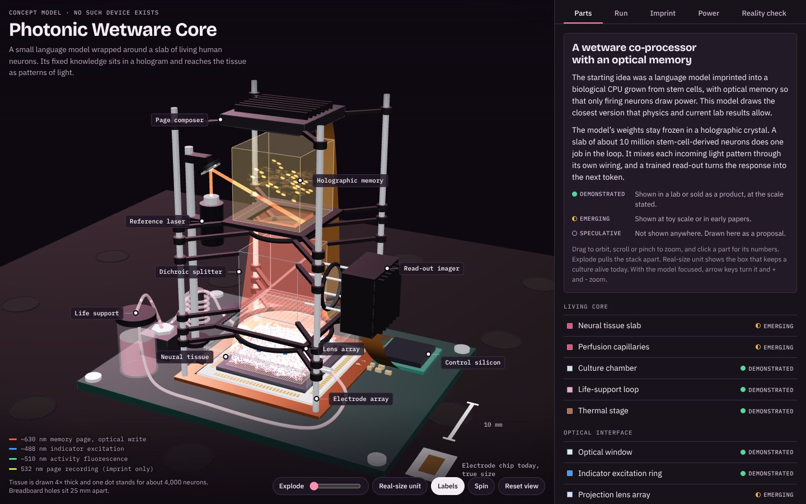

# Photonic Wetware Core

An explorable 3D model of one concept: a language model run around a slab of
living, stem-cell-derived human neurons, with its fixed knowledge held in an
optical (holographic) memory.

**No such device exists.** The model draws the closest version of the idea that
physics and current lab results allow, and tags every part and step as
*demonstrated*, *emerging* or *speculative*.



## What is in here

| File | What it is |
|---|---|
| `index.html` | The page: stage, panel, styles. Written as an Artifact page fragment (no `<html>`/`<body>` wrapper). |
| `scene.js` | The 3D model, built in millimetres with three.js r147, plus a small spiking-network cartoon in the tissue. |
| `data.js` | All text and numbers: parts, run cycle, imprint pipeline, power budget, reality check, sources. |
| `app.js` | Panel, timeline and wiring between the two. |
| `photonic-wetware-core.glb` | The same geometry as a static binary glTF, true size in metres, one node per part. Opens in Blender, Windows 3D Viewer, or any glTF viewer. |
| `tools/serve.cjs` | Local preview server. |
| `tools/export-glb.cjs` | Rebuilds the `.glb` from the live scene. |

## View it

```bash
node biocpu/tools/serve.cjs        # then open http://127.0.0.1:8765/
```

The page loads three.js from a CDN, so it needs a network connection.
Drag to orbit, scroll or pinch to zoom, click a part for its numbers. With
the model focused, arrow keys turn it and + and - zoom.

- **Explode** pulls the stack apart.
- **Real-size unit** shows the roughly shoebox-sized box that keeps under a
  million neurons alive in the one product sold today.
- **Run** plays one token through the loop, slowed 20 to 100 times.
- **Imprint** walks the seven-step route from a digital model to running tissue.
- **Power** shows a live, log-scale power budget and tests the idea's energy claims.
- **Reality check** lists the evidence behind every tag, with sources.

To rebuild the glTF after changing the scene (needs Playwright with Chromium):

```bash
node biocpu/tools/export-glb.cjs
```

## The design in one paragraph

The language model's weights stay frozen in a holographic crystal. A steering
mirror picks one stored page; the crystal returns it as a grid of light spots;
the spots land on a thin slab of about 10 million neurons, where cells carrying
a light-gated channel fire. The slab mixes that pattern through its own
recurrent wiring for a fraction of a second. A camera and an electrode array
read the response, and a linear read-out trained for that particular slab turns
it into the next token. Conventional silicon does the tokenising, decoding,
sampling and constant recalibration. It also keeps the read-out weights in
ordinary rewritable memory, because they are refit as the tissue drifts and
the crystal is written only at imprint.

Stack, bottom to top: carrier board and control silicon, thermal stage, CMOS
electrode array, perfused tissue slab in a glass culture chamber, optical
window, excitation ring, lens array, dichroic splitter (imager to the side),
relay lens, holographic crystal (reference laser and steering mirror to the
side), page composer.

## What the research changed

The starting brief was "imprint an LLM into a biological CPU grown from stem
cells, with optical memory, so only firing neurons take power and memory is
hyper-optimised". Four research passes, each followed by an adversarial
fact-check, moved the design in these ways.

**The model is not copied into the neurons.** Nobody can set or read individual
synaptic weights in living tissue. The best-known systems, from the
Pong-playing dish to the unit on sale, stimulate through 8 to 59 electrode
sites, and lab optics have addressed about 400 cells one at a time, against
tens to hundreds of millions of synapses. What has been shown is
tissue used as a reservoir with a read-out trained in silicon, so that is the
role the slab plays here.

**"Only firing neurons take power" does not hold.** Energy-budget models put 40
to 87% of cortical energy in resting potentials, housekeeping and glia, spent
whether or not a cell fires, and a rat brain made electrically silent still
used a third to a half of its normal ATP. Life support and electronics never
switch off: the one unit on sale is reported to draw about 30 W to keep well
under a milliwatt of neurons alive. What survives is the cost per event, an
estimated 14 to 26 fJ per synaptic event against about 24 pJ on a neuromorphic
chip.

**Optical memory is free to hold and costly to use.** A crystal or glass plate
holds data at 0 W, but so does unpowered flash, and holding weights in DRAM is
about 0.1% of inference power. Reading a holographic crystal costs about 16 nJ
of light per bit where an SSD spends about 1 nJ.

**Optical memory is not dense.** Shown so far: about 0.01 TB/cm³ for a
holographic crystal and about 0.2 TB/cm³ for laser-written fused silica,
against 1 to 12 TB/cm³ for packaged flash. Glass wins on lifetime: a
borosilicate version of the laser-written glass, at about 0.085 TB/cm³, is
projected past 10,000 years. A crystal's pages are extrapolated to last months to years, about as
long as unpowered flash.

**Geometry is set by oxygen.** Tissue without vessels survives only 0.3 to
0.4 mm from a supply surface, so the tissue is a thin perfused slab and not a
brain-shaped block. It is drawn four times thicker than real.

**At about 50 W while generating, the module would need 14 to 100 tokens per
second to match GPUs.** The tissue caps it near 2 to 10, and no neural culture
has yet produced a token. The power budget adds up to about 65 W only with
every item switched on: the page composer (about 10 W) runs only at imprint,
and the laser, imager and LEDs are each on for only part of a cycle.

The idea does get three things right: neural tissue is extremely cheap per
event and adapts on its own; tissue is the wrong place to keep anything
permanent, so a separate non-volatile memory is the right call; and light is a
good bus to and from neurons because it reaches many cells without wires.

## Limits of this model

- Line items marked *est.* in the power budget are engineering estimates, and
  the budget as a whole has not been checked against hardware.
- Figures for the commercial unit (neuron count, power, lifetime, size) are
  vendor and press statements. The wire box in the real-size view is an
  estimate from "slightly larger than a shoebox".
- Per-neuron and per-event energies are model estimates from living brains.
  They have not been measured in cultured tissue.
- One research pass, on the optical interface to neurons, was stopped by the
  AI model's safety filter and was not rerun. The light-to-tissue path is
  therefore drawn at a general level. Light per evoked spike (worked out for a
  light-gated channel that answers to blue light), scattering depth and the roughly 400 addressable cells
  come from other passes; the indicator wavelengths, the lens array and the
  imaging cell count are general-knowledge placeholders. Optical storage
  hardware was checked separately.
- The memory is drawn more simply than it would work. Recording a page needs
  532 nm green light in both the page beam and the reference path, from a
  separate laser that is not drawn. Reading in red avoids erasing pages but
  brings back only a strip of each page per mirror angle. A crystal holding
  thousands of pages returns too little light to make neurons fire (at 10,000
  pages each page returned about 5 billionths of the laser light), so the
  write step needs far fewer pages stored at each place in the crystal, or
  far more laser power.
- The tissue animation is a cartoon. It is a small random network with
  excitatory and inhibitory cells, tuned to look like cascades that die out.
- The neurons would come from a human donor's cells. Scaling this idea raises
  consent and moral-status questions that the field's own roadmap asks to be
  handled inside the work. They are flagged in the Reality check tab and are
  not solved here.

Sources are listed in the Reality check tab and in `data.js`, most of them
with links.
